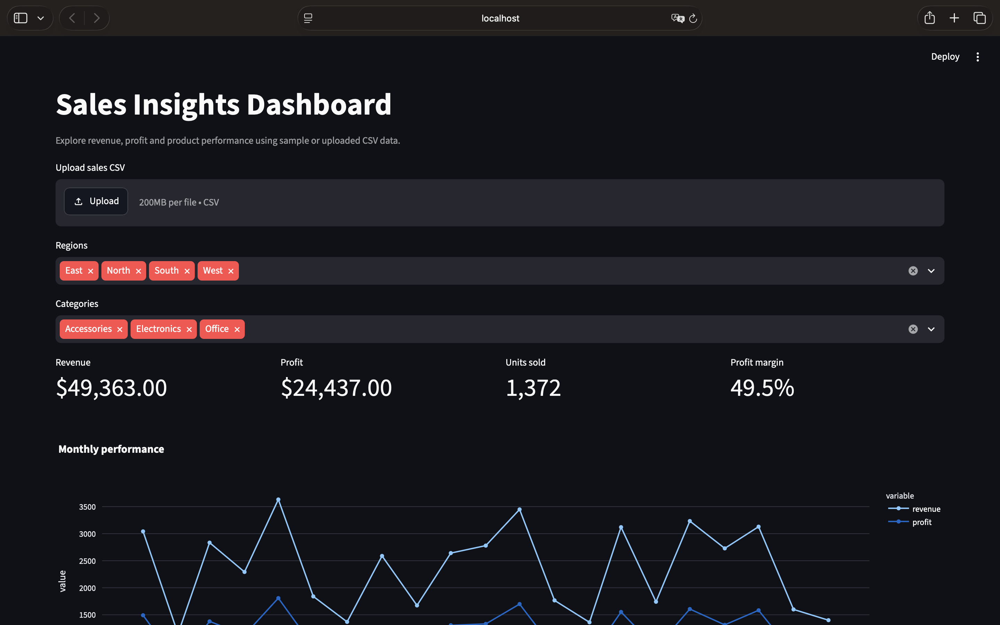

# Sales Insights Dashboard

Interactive Python data analytics project using **Pandas, Plotly, and Streamlit**.

## Dashboard Preview



## Features
- CSV upload and validation, cleaning, and computed revenue/profit
- Region and category filters, monthly trends, top products, export
- Automated unit tests and included **synthetic** sample data

## Run locally
```bash
python -m venv .venv
source .venv/bin/activate  # Windows: .venv\Scripts\activate
pip install -r requirements.txt
streamlit run app.py
```

## Test
```bash
python -m pytest -q
```

## Data format
Required columns: `date,region,category,product,quantity,unit_price,unit_cost`.
Sample sales are randomly generated and are not real business results.

## Resume bullet (after you review and run it)
Built a Python analytics dashboard with Pandas, Plotly, and Streamlit to validate sales data, calculate KPIs, and visualize performance trends with interactive filters.
